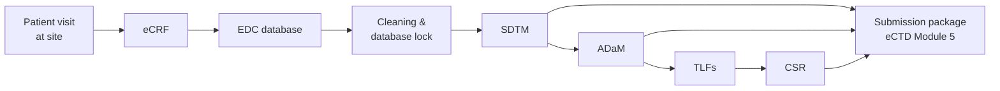

# CDISC & Regulatory Submission Primer

> **Audience:** anyone joining this project without a clinical-programming background, and Dataiku teams preparing to talk to pharma clinical teams.
> **Purpose:** explain the clinical data process, the CDISC standards, what regulators require, and which tools the industry uses today — so the rest of the documentation makes sense.

---

## 1. Why clinical trial data has to follow standards

A pharmaceutical company (the **sponsor**) runs clinical trials and then asks a regulator to approve its drug or vaccine:

| Regulator | Region | CDISC data required? |
|---|---|---|
| **FDA** (Food and Drug Administration) | United States | **Yes.** Required for NDA, BLA and ANDA submissions for studies starting after 17 Dec 2016 (INDs one year later), via the FDA *Data Standards Catalog*. |
| **PMDA** (Pharmaceuticals and Medical Devices Agency) | Japan | **Yes.** Mandatory since April 2020 after a transition period. |
| **NMPA** | China | Encouraged; increasingly expected. |
| **EMA** (European Medicines Agency) | European Union | Datasets are **not** routinely required today (piloting raw-data submission). |

The regulator receives written reports **and the underlying data**, so its reviewers can re-run analyses themselves. Because reviewers handle hundreds of submissions, every sponsor must deliver data in the same structure. **CDISC** (Clinical Data Interchange Standards Consortium), a non-profit, publishes those structures.

If submission data does not meet the technical requirements, the FDA can **refuse the submission automatically** (the *technical rejection criteria* — e.g. a missing trial-summary dataset, demographics dataset, subject-level analysis dataset or Define-XML) before any scientific review begins.

---

## 2. The clinical data journey



| Stage | What happens | Who does it |
|---|---|---|
| **eCRF** (electronic Case Report Form) | Site staff record each patient's visits, vital signs, adverse events, lab results… | Investigator sites |
| **EDC** (Electronic Data Capture) | The database behind the eCRFs | Data management |
| **Cleaning & database lock** | Data managers raise queries to sites to correct errors. When data is final, the database is *locked*; later changes require formal justification. | Data management |
| **SDTM** | Collected data reorganised into the standard tabulation format (§3) | Clinical / statistical programmers |
| **ADaM** | Analysis-ready datasets derived from SDTM (§3) | Statistical programmers |
| **TLFs** (Tables, Listings, Figures) | Statistical outputs defined in the SAP | Statistical programmers + biostatisticians |
| **CSR** (Clinical Study Report) | The full written study report, with the TLFs in it (structure defined by **ICH E3**) | Medical writing + biostatistics |
| **Submission** | Datasets, metadata, reviewer guides and reports packaged into the **eCTD** (electronic Common Technical Document); datasets go in Module 5 | Regulatory operations |

Two documents drive the analytics side:

- **Protocol** — how the trial is run: population, visits, measurements, endpoints.
- **SAP (Statistical Analysis Plan)** — written *before* the data is unblinded; defines every analysis and every output table, including its **number and title**. Statisticians and regulators treat it as a contract: outputs that deviate from the SAP must be justified.

---

## 3. The CDISC standards

### CDASH — collection
How to design eCRF fields so they convert cleanly to SDTM. Upstream of this asset.

### SDTM — tabulation ("what was observed")
Collected data organised into **domains**, each identified by a two-letter code, each with standard variable names:

| Domain | Contents | Used in this asset |
|---|---|---|
| DM | Demographics — one row per subject | ✔ |
| EX | Exposure — doses administered | ✔ |
| AE | Adverse events | ✔ |
| VS | Vital signs | ✔ |
| LB | Laboratory results (here also antibody titers) | ✔ |
| QS | Questionnaires (here the reaction diary) | ✔ |
| TS, TA, TV, SV, SE… | Trial design and subject-visit domains | ✘ (not in the POC) |

- Many values must come from **Controlled Terminology (CT)** — CDISC's official code lists (e.g. `SEX` must be `M`, `F`, `U`).
- The rulebook is the **SDTM Implementation Guide (SDTMIG)**. This asset validates against **SDTMIG 3.4**.

### ADaM — analysis ("ready to analyse")
Datasets derived from SDTM, shaped for statistics:

| Structure | Shape | Examples |
|---|---|---|
| **ADSL** (Subject-Level) | One row per subject; the "spine" all other datasets join to. Holds **population flags** (e.g. `SAFFL` = in the safety population). | ADSL |
| **BDS** (Basic Data Structure) | One row per subject × parameter × visit. Adds **baseline** (`ABLFL`, `BASE`) and **change from baseline** (`CHG`). | ADVS, ADIS |
| **OCCDS** (Occurrence Data Structure) | One row per event | ADAE |

- **Traceability** is a core ADaM principle: every derived value must be explainable back to SDTM.
- The rulebook is the **ADaM Implementation Guide (ADaMIG)** — v1.3 here.

### Define-XML — metadata
A machine-readable data dictionary shipped with the datasets: every dataset and variable, its label, type, length, allowed codes, and **how each derived value was computed**. Current version **Define-XML 2.1**. Mandatory for FDA and PMDA.

### Reviewer guides — human-readable metadata
- **cSDRG** — Clinical Study Data Reviewer's Guide (for SDTM)
- **ADRG** — Analysis Data Reviewer's Guide (for ADaM)

Templates are maintained by **PHUSE**. They explain study design, data conventions, and every **validation finding that was not fixed, and why**.

### XPT v5 — the file format
The FDA requires datasets as **SAS Transport version 5** files — a 1980s format with hard limits:

| Constraint | Limit |
|---|---|
| Dataset and variable names | ≤ 8 characters |
| Variable labels | ≤ 40 characters |
| Character values | ≤ 200 bytes |
| File size | Split files larger than 5 GB |

Every variable should carry a meaningful label (`AGE` → "Age").

### TLFs & the CSR
ICH E3 places summary **tables and figures in Section 14** (hence "Table 14.1.1") and **subject listings in Section 16** (e.g. "Listing 16.2.7 Adverse events"). The SAP lists each planned output by number.

### Therapeutic-area guidance
CDISC publishes **Therapeutic Area User Guides (TAUGs)** — e.g. for vaccines — describing how to model domain-specific data (reactogenicity, immunogenicity) in SDTM/ADaM.

---

## 4. What the submission package contains

```
m5/datasets/<study>/
├── tabulations/sdtm/      *.xpt  + define.xml + cSDRG.pdf
└── analysis/adam/
    ├── datasets/          *.xpt  + define.xml + ADRG.pdf
    └── programs/          analysis programs (requested by FDA for ADaM
                           derivations and key efficacy/safety results)
```

Key FDA references:

- **Study Data Technical Conformance Guide (TCG)** — the practical "how to submit data" guide.
- **Data Standards Catalog** — which standard versions FDA accepts.
- **Study Data Standardization Plan (SDSP)** — the sponsor's plan, agreed early with FDA, stating which standards each study will use.

Note that FDA asks for **programs** behind ADaM datasets and key results. In a visual-recipe world, this is why exportable flow documentation matters.

---

## 5. Validation: conformance vs. correctness

These are **two different questions**.

### 5.1 Conformance — "does the data follow the rules?"
Checked automatically by rule engines:

| Tool | Notes |
|---|---|
| **Pinnacle 21 Community** | Free desktop validator; industry default. |
| **Pinnacle 21 Enterprise** (Certara) | Commercial server product; also manages Define-XML and issue tracking. |
| **CDISC CORE** (Conformance Rules Engine) | CDISC's open-source engine (MIT licence); executes CDISC and FDA business rules. Used by this asset for SDTM. |

Validators return **findings** with severities. Not every finding must be fixed — many are explained in the reviewer guide — but rejection-level issues must be resolved.

### 5.2 Correctness — "are the numbers right?"
Industry practice is **independent double programming**: a second programmer rebuilds the same dataset or table from the specification without seeing the first programmer's code, and a compare tool (e.g. SAS `PROC COMPARE`, R `diffdf`) must show zero differences. Risk-based approaches (double programming only for critical outputs) are increasingly common.

---

## 6. Regulatory requirements on the *system*

Regulators also inspect **how** data was produced.

### GxP and computerized system validation
- **GxP** = "Good *x* Practice" (Clinical, Manufacturing, Laboratory…). For trials: **GCP**, guideline **ICH E6(R3)**.
- Systems handling trial data must be **validated** — documented evidence that they consistently do what they are intended to do. Common framework: **GAMP 5**; FDA's **Computer Software Assurance (CSA)** guidance promotes a risk-based approach.
- Qualification stages: **IQ** (installed correctly), **OQ** (functions work as specified), **PQ** (works for the real intended use).
- After validation, every change — including software upgrades — goes through **change control**.

### 21 CFR Part 11 — electronic records & signatures
FDA regulation; the clauses most relevant here:

| Clause | Requirement (plain words) |
|---|---|
| §11.10(a) | System is validated |
| §11.10(b) | Accurate, complete copies can be produced for inspectors |
| §11.10(c) | Records are protected and retrievable for the whole retention period |
| §11.10(d), (g) | Only authorised individuals can access, change, or sign |
| §11.10(e) | Secure, computer-generated, time-stamped **audit trail** that never obscures prior values |
| §11.10(f) | System enforces the **permitted sequence of steps** |
| §11.10(i), (j) | Users are trained; written policies hold people accountable for their signatures |
| §11.50 | A signature shows **printed name, date/time, and meaning** (review, approval, authorship…) |
| §11.100, §11.200 | A signature belongs to **one individual**; signing requires identification (e.g. ID + password) |

### Data integrity — ALCOA+
Data must be **A**ttributable, **L**egible, **C**ontemporaneous, **O**riginal, **A**ccurate — plus Complete, Consistent, Enduring, Available.

### Segregation of duties
Author ≠ independent reviewer ≠ approver. Self-approval is a classic inspection finding.

### Reproducibility
Years later, an inspector may ask a sponsor to regenerate an output **exactly**. That needs the exact data version, code version, package versions and platform version.

---

## 7. Incumbent tools — what pharma uses today

This map helps position the asset in a **SAS-replacement** conversation. Vendor lists are illustrative, not exhaustive.

| Process step | Typical incumbent tools | Open-source / modern alternatives | This asset |
|---|---|---|---|
| **Data capture (EDC)** | Medidata Rave, Veeva Vault CDMS, Oracle Clinical One / InForm | OpenClinica, REDCap (academic) | Out of scope |
| **Data cleaning & review** | EDC edit checks, elluminate, JReview, Spotfire, SAS JMP Clinical | — | Out of scope |
| **Standards / metadata repository (MDR)** | Formedix ryze (Certara), P21 Enterprise data standards, SAS Clinical Standards Toolkit, in-house MDRs | CDISC Library API | ✘ (roadmap: spec-driven metadata) |
| **Statistical Computing Environment (SCE)** | SAS Life Science Analytics Framework (LSAF), entimICE, SAS Grid / PC SAS | Domino, Posit Workbench, **Dataiku** | **Dataiku DSS** |
| **Raw → SDTM mapping** | SAS macros, SAS Clinical Data Integration, EDC-native mapping tools | `sdtm.oak` (pharmaverse, R) | ✘ (SDTM is the input) |
| **SDTM → ADaM derivation** | SAS macros (in-house libraries) | `admiral` + `metacore`/`metatools` (pharmaverse, R) | Dataiku visual recipes + `admiral` |
| **XPT v5 export** | SAS `PROC COPY` / XPORT engine, `%loc2xpt` | `xportr`, `haven` (R); `pyreadstat` (Python) | `xportr` |
| **Define-XML** | P21 Enterprise, Formedix ryze, SAS Clinical Standards Toolkit | Emerging open-source generators | ✘ (roadmap) |
| **Conformance validation** | Pinnacle 21 Community / Enterprise | CDISC CORE | CORE (SDTM) + P21 Community (ADaM, manual) |
| **Independent QC / compare** | SAS double programming + `PROC COMPARE` | R `diffdf`; Dataiku compare recipes | ✘ (roadmap) |
| **TLF production** | SAS `PROC REPORT` + ODS RTF, in-house macro libraries | `rtables`, `tern`, `Tplyr`, `gt`, `r2rtf` (R) | `rtables`/`tern`, text/CSV output |
| **Medical / safety review dashboards** | Spotfire, JReview, JMP Clinical, elluminate | Shiny, Dataiku dashboards | ✘ (roadmap) |
| **Version control & audit trail** | SCE-native versioning (LSAF), ClearCase, SVN | Git | Dataiku project Git + Govern |
| **Approvals / governance** | SOP + paper/eDMS sign-off, Veeva Vault QualityDocs | — | **Dataiku Govern** gated workflow |
| **Electronic signatures (Part 11)** | DocuSign Part 11 module, Veeva Vault, OpenText Documentum | — | ✘ (customer's e-signature system, linked via Govern API) |
| **eCTD publishing & gateway** | Lorenz docuBridge, Extedo, Veeva Vault Submissions Publishing; FDA ESG | — | Out of scope |

### Where the SAS-replacement conversation usually lands
- **Pain points with SAS:** licence cost, shrinking talent pool, opaque macro libraries, slow onboarding, difficult reuse across studies.
- **Industry momentum:** the **pharmaverse** consortium (Roche, GSK, Novartis and others) maintains open-source R packages covering SDTM → ADaM → TLF; R-based submissions have been accepted by the FDA (R Consortium submission pilots).
- **The usual objection:** "Open source is fine, but how do we validate it, govern it and make it auditable?" — which is exactly where a governed platform like Dataiku fits.

---

## 8. Glossary

| Term | Meaning |
|---|---|
| ADaM | Analysis Data Model |
| ADRG / cSDRG | Analysis / Clinical Study Data Reviewer's Guide |
| ALCOA+ | Data-integrity principles (Attributable, Legible, Contemporaneous, Original, Accurate + Complete, Consistent, Enduring, Available) |
| CDASH | Clinical Data Acquisition Standards Harmonization |
| CORE | CDISC Open Rules Engine |
| CSR | Clinical Study Report |
| CT | Controlled Terminology |
| eCTD | electronic Common Technical Document |
| EDC | Electronic Data Capture |
| GMT / GMFR | Geometric Mean Titer / Geometric Mean Fold Rise (vaccine immunogenicity) |
| HAI | Hemagglutination Inhibition assay (flu antibody titer) |
| IQ / OQ / PQ | Installation / Operational / Performance Qualification |
| MDR | Metadata Repository |
| P21 | Pinnacle 21 |
| SAP | Statistical Analysis Plan |
| SCE | Statistical Computing Environment |
| SDTM / SDTMIG | Study Data Tabulation Model / its Implementation Guide |
| Seroconversion / Seroprotection | ≥ 4-fold titer rise / titer ≥ 1:40 |
| TAUG | Therapeutic Area User Guide |
| TCG | FDA Study Data Technical Conformance Guide |
| TEAE | Treatment-Emergent Adverse Event |
| TLF | Tables, Listings and Figures |
| XPT | SAS Transport file (v5 required by FDA) |

## 9. Further reading

1. CDISC — SDTM and ADaM overview pages; implementation guides (free with registration)
2. FDA — *Study Data Technical Conformance Guide* and *Data Standards Catalog*
3. FDA — *Part 11, Electronic Records; Electronic Signatures — Scope and Application* and *Electronic Systems, Electronic Records, and Electronic Signatures in Clinical Investigations: Q&A*
4. ICH E3 (CSR structure), E6(R3) (GCP), E9 (statistical principles)
5. pharmaverse.org — `admiral`, `xportr`, `sdtm.oak`, `rtables`/`tern`
6. PHUSE — reviewer-guide templates and white papers
7. Dataiku — *Statement of Quality: how Dataiku can assist customers with GxP compliance* (July 2026)
