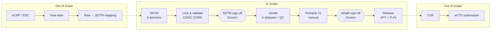

# FLU2026 CDISC Submission Pipeline — Overview

> **Status:** MVP / conversation starter — *draft documentation, reflects the project state as of 2026-10-21.*
> **Dataiku project:** `CLIN_FLU2026_VISUAL` (app template "FLU2026 — CDISC Submission Validation")
> **Data:** synthetic Phase II flu-vaccine study, 50 subjects. **Not for submission or clinical use.**
> New to CDISC? Read the [CDISC & submission primer](00-cdisc-submission-primer.md) first.

---

## What this asset is

A working example of a **governed SDTM → ADaM → TLF pipeline** in Dataiku, built for clinical teams evaluating a **self-hosted SAS replacement**. It shows how visual recipes, the open-source pharmaverse toolchain and Dataiku Govern combine into one auditable workflow.

It is designed to **start a conversation**, not to be a submission-ready product. The [limitations](04-responsibilities-and-limitations.md) are stated plainly so that each gap becomes a discovery question.

## Three key messages

1. **SAS replacement is realistic.** Most ADaM derivation is data plumbing (joins, filters, computed columns, aggregations), which visual recipes handle without code: **3 of the 5 ADaM datasets use no code**. The CDISC-specific parts use the industry's own open-source tools — `admiral` for baseline derivations, `xportr` for XPT export, `rtables`/`tern` for tables, CDISC CORE for conformance.
2. **Governance is built into the pipeline.** ADaM can't be built until SDTM is approved, and the submission can't be released until ADaM is approved. **Any change to the data or the pipeline code automatically revokes approvals.** In most SAS environments these rules are enforced by SOPs, not by the system.
3. **It fits the customer's validated environment.** It's designed for a self-managed Dataiku install, with a clear split between what Dataiku provides, what this asset provides, and what the customer owns.

---

## Scope

Relative to the end-to-end CRF-to-CSR process (deck slide 5), the asset covers **SDTM validation through ADaM, TLFs and the XPT package**. SDTM is the *input*: the asset validates and locks it but doesn't create it.

---

## Deliverables

### Data outputs (Dataiku project)

| Deliverable | Where | Built by |
|---|---|---|
| SDTM XPT v5 files (DM, EX, AE, VS, LB, QS) + manifest | Folder `SDTM_XPT` | `sdtm_xpt_export` (Python) |
| SDTM conformance report (CDISC CORE, SDTMIG 3.4) — `.xlsx` + `.json` | Folder `SDTM_REPORT`, dataset `SDTM_VALIDATION` | `validate_sdtm` (Python, CORE 0.16.0) |
| **ADSL** — subject level, population flags | Dataset | Visual only (Group + Join + Prepare) |
| **ADAE** — adverse events, treatment-emergent flag | Dataset | Visual only (Join + Prepare) |
| **ADREACT** — reactogenicity diary | Dataset | Visual only (Join + Prepare) |
| **ADVS** — vital signs, change from baseline | Dataset | Visual + ~12 lines of `admiral` (baseline) |
| **ADIS** — immunogenicity: titers, fold-rise, seroprotection, seroconversion | Dataset | Visual + ~12 lines of `admiral` (baseline) |
| ADaM QC — 26 in-flow conformance checks | Dataset `ADAM_VALIDATION` | `validate_adam` (R) |
| ADaM XPT v5 files + manifest | Folder `SUBMISSION_XPT` | `xpt_export` (R, `xportr`) |
| TLFs — 4 summary tables (`.txt` + `.csv`) + `tlf_package.zip` | Folder `TLF_OUTPUT` | `tlf_generate` (R) |

### Governance outputs (Dataiku Govern)

| Deliverable | Notes |
|---|---|
| Study validation record (one per study) | Holds conformance results, data and code fingerprints, sign-off status, and links to the dataset records |
| 3-step workflow | **SDTM Validation → ADaM Validation → ADaM Validated** |
| 2 mandatory sign-offs | SDTM Validation, ADaM Validation (role: Lead Statistician) |
| Attached study documents | ADRG, SDRG and SAP drafts (synthetic) |

### Operator experience

- **App homepage** with 7 numbered steps that guide the user from SDTM lock to release (see the [demo script](02-demo-script.md)).
- **3 wiki articles** in the project: pipeline explanation, visual-first design rationale, Govern sign-off gates.

---

## How the flow is organised

| Zone | Built with | What happens |
|---|---|---|
| 1 · SDTM inputs | — | 6 SDTM domains |
| 2 · ADSL | Group + Join + Prepare | Treatment dates, AE roll-up, population flags, age bands — **no code** |
| 3 · ADVS | Join + Prepare + small R step | Baseline via `admiral`; the rest is visual |
| 4 · ADIS | Prepare + Join + small R step + Prepare | HAI strain mapping, fold-rise, seroprotection, seroconversion as visual formulas; baseline via `admiral` |
| 5 · ADAE | Join + Prepare | Study day, duration, severity, relatedness, treatment-emergent flag — **no code** |
| 6 · ADREACT | Join + Prepare | Reaction severity, any/severe flags — **no code** |
| 7 · Validation | R | 26 cross-dataset QC checks |
| 8 · Submission XPT | R (`xportr`) | SAS Transport v5 files |
| 9 · TLF reporting | R (`rtables`/`tern`) | Summary tables |

Code is used only where no visual recipe can do the job: CDISC baseline semantics, SAS Transport output, table rendering, and the CORE engine.

---

## How governance is enforced

Govern and the Design node are separate systems, so a Govern approval can't stop a build on its own. Enforcement is layered:

1. **The sign-off in Govern is the source of truth.**
2. **Each gated scenario starts with a Python check** that reads the sign-off status through the built-in DSS↔Govern connection and **aborts the build** if the gate isn't met.
3. **Fingerprints detect drift.** `build_sdtm` records a hash of the SDTM data and of every recipe's code. If either changes later, the gates **revoke all sign-offs** and roll the workflow back to SDTM validation.

| Scenario | Gate |
|---|---|
| `build_sdtm` | — (records conformance and fingerprints, opens the SDTM sign-off) |
| `build_adam` | SDTM sign-off approved + conformance PASS + fingerprints unchanged |
| `release_submission` | Both sign-offs approved + ADaM conformance PASS + fingerprints unchanged |
| `governance_integrity_check` | Hourly sweep that revokes on drift (currently **inactive**) |

---

## Real today vs. roadmap

| Capability | Status |
|---|---|
| Visual-first ADaM derivation with open-source CDISC tooling | ✅ Working |
| Gated workflow with Govern sign-offs and automatic revocation on drift | ✅ Working (see [known issues](05-mvp-backlog-internal.md)) |
| SDTM conformance (CDISC CORE) | ✅ Working (gate logic needs fixing) |
| XPT v5 export | ✅ Working (labels not yet spec-driven) |
| ADaM conformance (Pinnacle 21) | ⚠️ Manual, outside Dataiku |
| TLFs | ⚠️ 4 summary tables; no listings or figures, no RTF |
| Define-XML | ❌ Roadmap |
| Independent double-programming comparison | ❌ Roadmap |
| Raw → SDTM mapping, EDC/API ingestion | ❌ Roadmap |
| Part 11 electronic signatures | ❌ Customer's e-signature system, linked through the Govern API |
| On-premise install package, IQ/OQ/PQ kit | ❌ For a committed pilot |

---

## Documentation set

| Document | For |
|---|---|
| [00 · CDISC & submission primer](00-cdisc-submission-primer.md) | Background: standards, regulation, incumbent tools |
| **01 · Overview** (this page) | What the asset is and does |
| [02 · Demo script](02-demo-script.md) | Running the demo and the discovery conversation |
| [03 · Architecture & prerequisites](03-architecture-and-prerequisites.md) | Target deployment, licences, installation checklist |
| [04 · Responsibilities & limitations](04-responsibilities-and-limitations.md) | Part 11 shared responsibility, honest limitations |
| [05 · MVP backlog (internal)](05-mvp-backlog-internal.md) | Known issues and the prioritised fix list — **do not share externally** |
