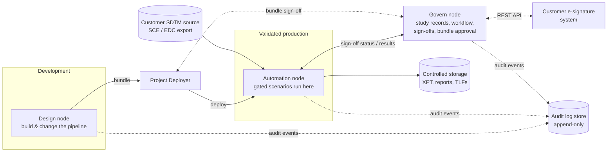

# Architecture & Prerequisites

> **Audience:** solution architects, customer IT / platform teams, validation leads.
> **Deployment target:** **self-managed (on-premise or customer cloud tenant) Dataiku.** The asset is developed on Dataiku Cloud for convenience only.

---

## 1. Why self-managed

For a GxP use case, a self-managed install lets the customer own the elements regulators inspect (see Dataiku's *Statement of Quality*, July 2026):

| Concern | Self-managed | Dataiku Cloud |
|---|---|---|
| Platform validation (IQ/OQ/PQ) | Fully under customer control | Customer validates; Dataiku deploys and changes the platform under its own change control |
| **Upgrade timing** | Customer decides and re-tests before upgrading | Upgrades are applied by Dataiku |
| Audit-log retention | Can forward to the customer's append-only log store | About one year available to the customer by default |
| Data location | Never leaves customer infrastructure; Dataiku has no access | Hosted by Dataiku |
| Backups & disaster recovery | **Customer responsibility** | Dataiku backs up project configuration (not customer data stores) |

---

## 2. Target architecture

- **Development vs. validated production.** Change the pipeline on the Design node, package it as a **bundle**, and promote it through the **Project Deployer** after a Govern bundle approval. Validated runs happen on the **Automation node**.
- **Govern** holds one validation record per study and gates every stage.
- **Part 11 electronic signatures** come from the customer's e-signature system, linked to the Govern sign-off steps through the Govern REST API (Govern isn't an e-signature system).

> 🔎 **To confirm with Dataiku before committing to a design:** how the app homepage (the 7-step operator page) behaves when the project is deployed to an Automation node rather than instantiated on a Design node.

---

## 3. Component inventory

### Dataiku project `CLIN_FLU2026_VISUAL`

| Type | Count | Notes |
|---|---|---|
| Datasets | 27 | 6 SDTM inputs, 5 ADaM outputs, 2 validation tables, 14 intermediates |
| Recipes | 24 | 17 visual (Join, Group, Prepare), 5 R, 2 Python |
| Managed folders | 6 | `CORE_ENGINE`, `SDTM_XPT`, `SDTM_REPORT`, `SUBMISSION_XPT`, `P21_ADAM_REPORT`, `TLF_OUTPUT` |
| Scenarios | 5 active + 3 deprecated | `build_sdtm`, `build_adam`, `release_submission`, `governance_integrity_check`, `debug_reset_signoffs` |
| App homepage | 7 operator sections + 1 debug section | |
| Wiki articles | 3 | |
| Project variable | `govern_artifact_id` | ID of the study's Govern record |

### Code environments

| Environment | Language | Used by | Packages | Version pinning |
|---|---|---|---|---|
| `cdisc_core` | Python 3.12 | `validate_sdtm`, `sdtm_xpt_export` | `cdisc-rules-engine==0.16.0` + dependencies | ✅ All versions pinned |
| `cdisc_adam_r` | R | `flag_vs_baseline`, `flag_adis_baseline`, `validate_adam`, `xpt_export`, `tlf_generate` | `admiral`, `xportr`, `haven`, `rtables`, `tern`, `dplyr`, `tidyr` | ❌ **Not pinned**, installed from public CRAN. Pin before any validated use. |

### Govern objects

| Object | Current (development) | Target (packaged asset) |
|---|---|---|
| Blueprint | Version `bv.adam_validation_2` of the shared **Asset Inventory** blueprint | **Dedicated blueprint** (e.g. "CDISC Study Validation") |
| Workflow | SDTM Validation → ADaM Validation → ADaM Validated | Same |
| Sign-offs | 2 mandatory; approvers are the `administrators` group (incl. API keys) + named users | Approvers assigned through **Govern roles** (Reviewer, Final approver); no API keys |
| Record | `ar.114`, shared by every app instance | **One record per study / app instance** |
| Integrity hook | Described in the wiki (blocks *Validated* while a result is *Fail*) | To be verified with an admin key and exported with the blueprint |

---

## 4. Prerequisites

### Licences

| Item | Why |
|---|---|
| Dataiku DSS (developed on **15.0.2**) | Platform |
| **Govern node** | Not included in every licence |
| **Advanced Govern** (additional licence) | Required for custom blueprints, workflows and sign-offs |
| Enterprise licence features: **User Isolation Framework** | Recommended: per-user traceability and non-repudiable audit logs |
| Pinnacle 21 Community (free) or Enterprise | ADaM conformance step |

### Platform configuration

| Item | Detail |
|---|---|
| DSS ↔ Govern integration | Enabled in DSS administration; gate scripts use `dataiku.api_client().get_govern_client()` |
| Scenario run-as user | A dedicated **service account** with the Govern rights the gates need (currently an admin) |
| SSO / named accounts | One identity per person; no shared accounts |
| Audit-log forwarding | DSS and Govern audit events to the customer's long-term, append-only store |
| Package mirrors | Internal PyPI and CRAN mirrors (or a dated CRAN snapshot) if there's no internet access |

### Connections to remap

| Development (Cloud) | Used by | On-premise target |
|---|---|---|
| Uploaded files | 6 SDTM input datasets | Connection to the customer's SDTM source (SCE share, database or EDC export) |
| `filesystem_managed` | Intermediate and ADaM datasets, folders | Customer managed storage with backup and retention |
| `dataiku-managed-storage` (S3) | `SDTM_VALIDATION` | Same customer storage as above |

### Hard-coded values to parameterise

| Location | Value |
|---|---|
| App homepage sections 3 and 6 | Govern URL `https://govern-…/artifact/ar.114/…` |
| App homepage sections 1, 3, 5, 6 and debug | Text references to `ar.114` |
| Gate scripts | Fallback to `ar.114` when `govern_artifact_id` is unset |

### CDISC CORE rules

The CORE engine ships as `core_vendor.zip` in the `CORE_ENGINE` folder. Confirm whether it needs online access to the **CDISC Library** to fetch rules. For a validated environment, ship a **frozen rules cache** so the rule set only changes under change control.

---

## 5. Installation checklist (outline)

1. **Govern:** create the dedicated blueprint (import the exported version), the sign-off configurations, the roles and their assignments; activate the version.
2. **Code environments:** create `cdisc_core` (pinned list) and `cdisc_adam_r` (pinned versions); record the versions in the validation documentation.
3. **Project:** import the bundle; remap connections and code environments.
4. **Configuration:** set `govern_artifact_id`, the homepage Govern links, the scenario run-as user, and the DSS↔Govern integration.
5. **Study record:** create the study's Govern record and link it.
6. **Smoke test:** run `build_sdtm` → approve → `build_adam` → approve → `release_submission` on the synthetic data; then test a drift revocation.
7. **Validation:** execute the customer's IQ/OQ/PQ protocols. The smoke test above is a starting point for OQ test cases.

> This checklist is an outline. A scripted installer and an IQ/OQ test pack are out of MVP scope and would be built for a committed pilot.
